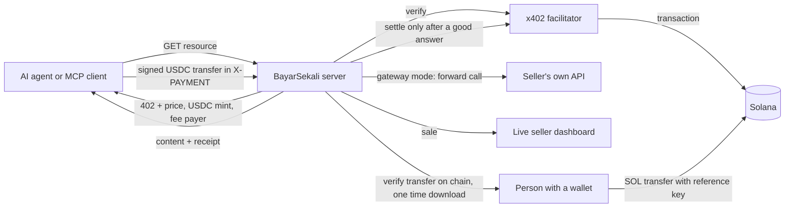

# BayarSekali

**The paywall AI agents can pay.** Sell data, APIs and digital products to people and AI agents, paid per use in USDC on Solana through the x402 protocol. Wrap an API you already run or upload a file, share one link, and every payment lands straight in your wallet. No accounts, no platform cut, settlement verified on chain before anything unlocks.

**Live:** https://bayarsekali.indonesiacentral.cloudapp.azure.com
**Network:** Solana devnet. Every payment uses test funds with no real value.

## For judges: try it in 30 seconds

1. Open the live site and press **Let the AI agent buy it**. A demo agent with its own devnet USDC wallet asks for a product, receives an HTTP 402, checks its spending limits, signs, and gets the content once the payment settles on Solana. Every step streams to the page, with the Explorer link at the end. No wallet or install needed.
2. Open the [seller dashboard](https://bayarsekali.indonesiacentral.cloudapp.azure.com/seller/BW66pCspdPt8RH4bBGy8NGVSf2xMFNb3mr7FzWji8SML) in another tab and watch the sale land live.
3. Want your own agent to shop? Add the MCP server (below) to Claude Desktop or Claude Code and ask it to buy something within a budget.

## Why

AI agents are becoming buyers, but they can not fill in a card form or open an account. Sellers, especially outside the US, struggle to get paid globally in small amounts. x402 lets any HTTP request carry a payment, and Solana settles it in seconds for a fraction of a cent. BayarSekali is the seller side of that: a paywall and API gateway any agent or person can pay. We start with Indonesia: local knowledge and data that AI agents need but can not buy today.

## How it works

## The x402 API gateway

A seller lists an API they already run: its https URL and, optionally, a secret header such as their own API key. Every paid call is forwarded to that API with the buyer's query parameters, and the buyer is only charged when the API answers successfully: the payment is verified first, the API is called, and only a good answer is settled. The URL and secret never leave the server. Because the server fetches seller supplied URLs, the gateway is guarded against server side request forgery: https on the standard port only, no redirects, a timeout and a 1 MB limit, and every resolved address must be public, checked inside the socket's own DNS lookup so a rebinding hostname can not reach private or cloud metadata addresses.

## The human door: files for SOL

A creator lists a digital file with a price in SOL and gets a shareable link. A buyer opens the link, connects a Solana wallet, pays the exact amount, the backend verifies the payment on chain, and a one time download unlocks. No accounts. No platform cut. The money goes straight to the seller wallet.

## The agent door: API access through x402

A creator lists API access with a price in USDC and gets a resource URL. Any x402 aware client, human or agent, that asks for the resource receives an HTTP 402 carrying the payment requirements. The client builds and signs a Solana transaction, retries with an `X-PAYMENT` header, a facilitator verifies and settles the payment on chain, and the server delivers the content in the same response. The buyer never pays network fees; the facilitator does.

This door implements the x402 v2 `exact` scheme for Solana against the public facilitator at x402.org, including the parts that only show up when a real facilitator checks your work:

- The payment transaction must follow the static verification layout from section 3.1 of the SVM exact scheme spec, in relative order: `SetComputeUnitLimit`, `SetComputeUnitPrice`, a `TransferChecked`, and a Memo instruction carrying a random nonce of at least 16 bytes, hex encoded. Any other shape falls through to the smart wallet path and is rejected.
- The facilitator pays network fees only. It will not fund account creation, so a missing recipient token account is created first, in a separate transaction paid by the buyer.
- Settlement is confirmed on chain before the resource is served, and every settled payment is recorded as a sale on the listing.
- One payment buys exactly one delivery. Every payment transaction is claimed in a server side registry, keyed by the hash of its serialized bytes, before the facilitator is called. A captured `X-PAYMENT` header can never be settled or served twice, not even by two requests racing each other, and a payment settled for one resource can never unlock another.
- A buyer who paid is never refused. If the facilitator's settle call breaks off without an answer, the server looks for the payment on chain (same memo nonce and the buyer's own signature, so a forged copy can not match) and delivers if it landed. Otherwise the claim is left as unknown, and a retry with the same `X-PAYMENT` header checks the chain first, so the same payment is never charged twice.

## Proof, not promises

An agent buyer settled a real 0.01 USDC payment for a dataset listing on this deployment. The facilitator paid the network fee; exactly 0.01 USDC moved to the seller token account.

Transaction: https://explorer.solana.com/tx/5wXRwLGHiSMq5MQLZJ34vNxgFdGSPJAEWid1MCgxHwtVk5BxeKWXa4sJVEGMWnVien1ynSr1G9qZXecYbsurbeR3?cluster=devnet

## The autonomous agent buyer

`server/x402-client.mjs` is a reusable buyer library: `payForResource({ resourceUrl, keypair, connection })` runs the whole flow, and `buildPaymentTransaction` exposes the spec shaped transaction builder on its own. On top of it, `server/agent-buy.mjs` is a standalone agent client. It holds its own wallet, discovers the price by asking for the resource, signs the payment itself, and receives the content. No browser, no human in the loop.

    cd server
    npm install
    AGENT_KEYPAIR=/path/to/agent-keypair.json node agent-buy.mjs https://bayarsekali.indonesiacentral.cloudapp.azure.com/api/resource/<listing-id>

Fund the agent wallet with devnet USDC from faucet.circle.com (choose Solana, then Devnet). A little devnet SOL is only needed if a receiving token account has to be created first.

The same flow also runs in the browser: every API listing page carries a step by step agent buyer demo that connects Phantom and settles a payment live.

## The agent door as an MCP server

`server/mcp.mjs` turns the buyer library into an MCP server, so any MCP client (Claude Desktop, Claude Code, Cursor) can shop on BayarSekali by itself: browse the catalog, read a product, and pay for an API product in USDC over x402, getting the content back in the same tool call. The agent's keypair stays on the local machine; only signed payment transactions leave it.

Tools: `list_products`, `get_product`, `wallet_status`, `buy_api_access` (a BayarSekali `listing_id`, or any x402 Solana devnet `resource_url`).

Spending is fenced before anything is signed. The price comes from the server's own 402 answer and must be on Solana devnet, in USDC, at most `AGENT_MAX_PER_PURCHASE_USDC` (default 0.1), and within `AGENT_BUDGET_USDC` for the session (default 0.5). `AGENT_ALLOWED_SELLERS` optionally limits payees. A payment that left the process counts against the budget even if its answer was lost.

    cd server && npm install

Claude Desktop (`claude_desktop_config.json`) or any client with the same shape:

    {
      "mcpServers": {
        "bayarsekali": {
          "command": "node",
          "args": ["/absolute/path/to/bayarsekali/server/mcp.mjs"],
          "env": {
            "AGENT_KEYPAIR": "/absolute/path/to/agent-keypair.json",
            "AGENT_BUDGET_USDC": "0.5",
            "AGENT_MAX_PER_PURCHASE_USDC": "0.1"
          }
        }
      }
    }

Claude Code: `claude mcp add bayarsekali -e AGENT_KEYPAIR=/path/to/agent-keypair.json -- node /path/to/server/mcp.mjs`

Then ask: "Find a content calendar for my small business on BayarSekali and buy it." Every settled purchase also lands live on the seller dashboard.

## Seller dashboard

There are no accounts in BayarSekali; the wallet is the identity. Every listing page links to a public dashboard at `/seller/<wallet>` showing all of that wallet's listings, a live sales feed of every settled x402 sale with its explorer link, and the exact USDC total. It refreshes every few seconds and highlights a sale the moment it lands.

## Judge mode: the demo agent

The live site carries a server side demo agent with its own devnet USDC wallet, so anyone can watch an agent pay without installing a wallet. It buys through exactly the same x402 flow as any external agent, streams every step to the page, and spends under hard limits: a per purchase cap, a daily budget counted from its recorded runs, an allowlist of sellers, one run at a time, and a per visitor rate limit. Enable it with `DEMO_AGENT_KEYPAIR` (a funded devnet keypair file), `DEMO_MAX_PER_PURCHASE_USDC`, `DEMO_DAILY_BUDGET_USDC` and `DEMO_ALLOWED_SELLERS`.

## Sellers sign in with their wallet

The wallet that receives the money is the seller identity, and the seller proves it. Before a listing is created, the connected wallet signs a one time challenge message (free, no transaction). The server checks the ed25519 signature against `sellerWallet`, so nobody can list in someone else's name, and each challenge works once and expires after 5 minutes. Listing creation is also rate limited per address.

For scripts: `POST /api/auth/challenge { wallet }` returns `{ nonce, message }`; sign `message` (UTF-8 bytes) with the wallet and send `authNonce` and `authSignature` (base64 or base58) with the listing.

## Tests

The payment critical code is pinned by 44 automated tests: money math, payment header parsing, the local transaction check that mirrors the facilitator, the replay registry, one signature paying for one intent only, race safe tokens, the on chain lookup after a broken settle call, seller sign in, agent spending limits, the demo agent, and the gateway request guard. No network, no keys. CI runs them on every push.

    cd server
    npm test

## How the human door verifies payments

1. The buyer clicks Pay. The server creates a payment intent with a unique reference key.
2. The buyer signs a SOL transfer in their browser wallet. The transfer goes straight to the seller wallet and carries the reference key as a read only account key, Solana Pay style.
3. The server looks the reference up on devnet and adds up the System Program transfers to the seller in that transaction (top level and inner instructions). Reading the transfers rather than the seller's balance change keeps the check correct when the seller pays the fee, for example a seller test buying from their own listing.
4. The transaction signature is bound to that one intent, atomically. A transfer that carries several reference keys pays for one purchase only, never several.
5. The server issues a one time download token, valid for 15 minutes and exactly one download. If the file transfer breaks off, the token stays valid.

Verification is keyed only by the intent id, which only the buyer's browser holds. The reference key is public on chain the moment the buyer pays, so it is never accepted as proof of purchase. The browser keeps the intent id, so a buyer whose tab closed or whose link expired can ask for a fresh link (up to 5 per purchase).

Payments are signed only in the buyer's own wallet. This project never asks for, stores, or uses any private key or seed phrase. The agent buyer's keypair lives in a local file owned by whoever runs the agent and is never sent anywhere.

## Project layout

    server/   Node and Express API on port 8787, plus the agent buyer CLI
    web/      Vite and React frontend, served by the API in production

## Run it locally

Terminal 1, the API:

    cd server
    npm install
    npm start

Terminal 2, the frontend:

    cd web
    npm install
    npm run dev

Optional environment: `PUBLIC_BASE_URL` (the public origin used in x402 resource URLs and in the seller sign in message, recommended behind a proxy), `SOLANA_RPC_URL` (the RPC the server uses, and the one the browser reaches through `/api/rpc`; the public devnet RPC rate limits hard, so use a free Helius devnet URL for demos, and the key never ships to the browser), and `DATA_DIR` (store location).

Open the Vite URL (usually http://localhost:5173). The dev server proxies /api to http://localhost:8787. For a production style run, `npm run build` in web/ and the API serves web/dist itself.

## API summary

    POST /api/auth/challenge            body: { wallet }; one time message for the seller wallet to sign
    POST /api/listings                  create a listing (needs authNonce + authSignature): multipart file product, or JSON { type: "api", priceUsdc, resourceContent | upstreamUrl [+ secretHeaderName, secretHeaderValue], ... }
    GET  /api/listings                  public catalog, display fields only
    GET  /api/listings/:id              public listing info, never the file path or resourceContent
    GET  /api/listings/:id/sales        settled sales recorded for the listing
    POST /api/listings/:id/checkout     create a SOL payment intent with a reference key
    POST /api/payments/verify           body: { intentId }; a paid intent gets a fresh download link (max 5)
    GET  /api/resource/:id              the x402 door: 402 without payment, content after settlement
    GET  /api/download/:token           one time download, token dies after use or 15 minutes
    GET  /api/sellers/:wallet           live dashboard data: listings, sales newest first, exact USDC total
    GET  /api/demo/status               judge mode demo agent: wallet, balance, limits, budget left today
    POST /api/demo/agent-buy            body: { listingId }; the demo agent buys it, streamed as server sent events
    POST /api/rpc                       Solana JSON-RPC proxy for the browser, allowlisted read and send methods only
    GET  /api/health                    { ok: true }

## Notes

Listings, intents, tokens, and sales live in a small JSON file store under server/data, which is gitignored. Uploaded files live in server/uploads and are never served statically. In production the API runs as a systemd service behind Caddy with automatic HTTPS.

Built for the Dev3pack hackathon, November 2026.

## License

MIT, see [LICENSE](LICENSE). BayarSekali is open source.
